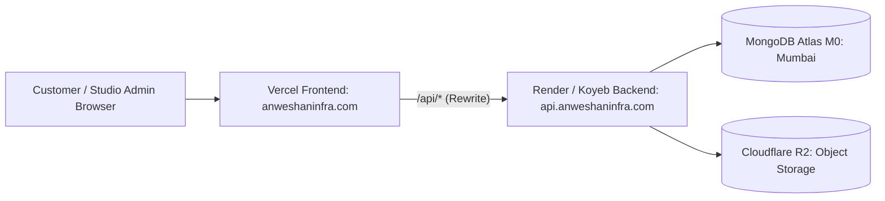

# ANWESHAN Infra — Production Deployment Guide (Free / Low-Cost Cloud)

This guide walks through deploying the complete ANWESHAN Infra website and backend on free and low-cost cloud infrastructure, ensuring **100% same-site cookie security** and persistent image storage.

---

## Architecture Overview



- **Frontend**: Hosted on **Vercel** with a URL rewrite rule `/api/:path*` forwarding to the backend. Because the browser communicates exclusively through `anweshaninfra.com`, all cookies remain strictly **first-party / same-site** (`SameSite=Lax`, `Secure=true`).
- **Backend**: Hosted on **Render Web Services** (free tier; sleeps after 15 min inactivity) or **Koyeb** (free tier alternative).
- **Database**: Hosted on **MongoDB Atlas** (Free M0 Shared Cluster in Mumbai `ap-south-1`).
- **Media Storage**: **Cloudflare R2** (10 GB free storage, zero egress fees). *Note: Render's free disk is ephemeral and resets on restart, making local disk storage dev-only.*

---

## Step 1: MongoDB Atlas (Database)

1. Sign up for a free account at [mongodb.com/atlas](https://www.mongodb.com/atlas).
2. Create a new cluster:
   - Select **M0 Free**.
   - Cloud Provider: **AWS**.
   - Region: **Mumbai (`ap-south-1`)** for lowest latency in India.
3. In **Database Access**:
   - Create a database user (e.g. `anweshan_admin`) with password.
4. In **Network Access**:
   - Add IP `0.0.0.0/0` (Allow access from anywhere) so Render/Koyeb dynamic IPs can connect.
5. In **Database** -> **Connect** -> **Drivers** (Python 3.12+):
   - Copy the connection string:
     ```
     mongodb+srv://anweshan_admin:<password>@cluster0.xxxxx.mongodb.net/anweshan_infra?retryWrites=true&w=majority
     ```

---

## Step 2: Cloudflare R2 (Persistent Media Storage)

1. Sign up or log into [Cloudflare Dashboard](https://dash.cloudflare.com).
2. Navigate to **R2 Object Storage**.
3. Click **Create bucket**:
   - Bucket name: `anweshan-media` (or your choice).
   - Location: Asia / Automatic.
4. Go to **R2** -> **Manage R2 API Tokens** -> **Create API Token**:
   - Permissions: **Object Read & Write**.
   - Specify bucket: `anweshan-media`.
5. Note down:
   - **Account ID** (from your Cloudflare R2 dashboard)
   - **Access Key ID**
   - **Secret Access Key**
   - **Bucket Name**

---

## Step 3: Backend Deployment (Render or Koyeb)

### Option A: Render (Recommended)
1. Sign up at [render.com](https://render.com) and link your GitHub repository.
2. Click **New +** -> **Web Service**.
3. Select your repository.
4. Configure service settings:
   - **Root Directory**: `backend`
   - **Environment**: `Python 3`
   - **Build Command**: `pip install -r requirements.txt`
   - **Start Command**: `uvicorn server:app --host 0.0.0.0 --port 10000 --proxy-headers`
   - **Plan**: Free
5. Add **Environment Variables**:
   ```ini
   ENV=prod
   MONGO_URL=mongodb+srv://anweshan_admin:<password>@cluster0.xxxxx.mongodb.net/anweshan_infra?retryWrites=true&w=majority
   DB_NAME=anweshan_infra
   JWT_SECRET=<32+_character_random_string>
   ADMIN_PASSWORD=<secure_initial_admin_password>
   ADMIN_EMAIL=admin@anweshaninfra.com
   COOKIE_SECURE=true
   COOKIE_SAMESITE=lax
   CORS_ORIGINS=https://anweshaninfra.com,https://your-frontend.vercel.app
   STORAGE_BACKEND=r2
   R2_ACCOUNT_ID=<your_cloudflare_account_id>
   R2_ACCESS_KEY_ID=<your_r2_access_key_id>
   R2_SECRET_ACCESS_KEY=<your_r2_secret_access_key>
   R2_BUCKET=anweshan-media

   # Optional Lead Notifications
   NOTIFY_TELEGRAM_BOT_TOKEN=
   NOTIFY_TELEGRAM_CHAT_ID=
   RESEND_API_KEY=
   NOTIFY_EMAIL_TO=
   TWILIO_ACCOUNT_SID=
   TWILIO_AUTH_TOKEN=
   TWILIO_WHATSAPP_FROM=
   OWNER_WHATSAPP=+918658429239
   ```
6. Click **Deploy Web Service**.
7. Copy the backend service URL (e.g. `https://anweshan-backend.onrender.com`).

---

## Step 4: Frontend Deployment (Vercel)

1. Sign up at [vercel.com](https://vercel.com) and import your Git repository.
2. Configure project:
   - **Framework Preset**: Create React App
   - **Root Directory**: `frontend`
   - **Build Command**: `craco build` (or `npm run build`)
   - **Output Directory**: `build`
3. Add **Environment Variables**:
   - `REACT_APP_BACKEND_URL=` (leave EMPTY so the frontend uses same-origin `/api`)
4. Create a `vercel.json` file inside `frontend/` (or in project root) to configure the reverse proxy rewrite:
   ```json
   {
     "rewrites": [
       {
         "source": "/api/:path*",
         "destination": "https://anweshan-backend.onrender.com/api/:path*"
       }
     ]
   }
   ```
5. Deploy the project.
6. The frontend now talks to `/api/*` directly on its own domain (`https://your-site.vercel.app/api/...`), and Vercel automatically proxies requests to Render. Because the domain matches, cookies (`access_token`, `refresh_token`) work automatically without third-party cookie blocking issues!

---

## Step 5: Post-Deployment Verification

1. **Verify Health**:
   - Visit `https://your-site.vercel.app/api/health` -> should return `{"status": "ok"}`.
   - Visit `https://your-site.vercel.app/api/ready` -> should return `{"status": "ready"}`.
2. **Verify Public Site**:
   - Visit `https://your-site.vercel.app`.
   - Ensure services, ideas gallery (with Homes / Shops / Furniture filters), and contact form function.
3. **Verify Admin Portal**:
   - Visit `https://your-site.vercel.app/admin`.
   - Log in using your configured administrator password.
   - Test photo upload (verify image stores in Cloudflare R2 and serves publicly).
   - Test editing a service price.
   - Test logging out.
